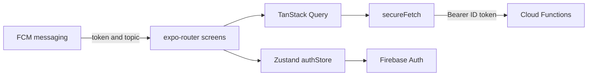
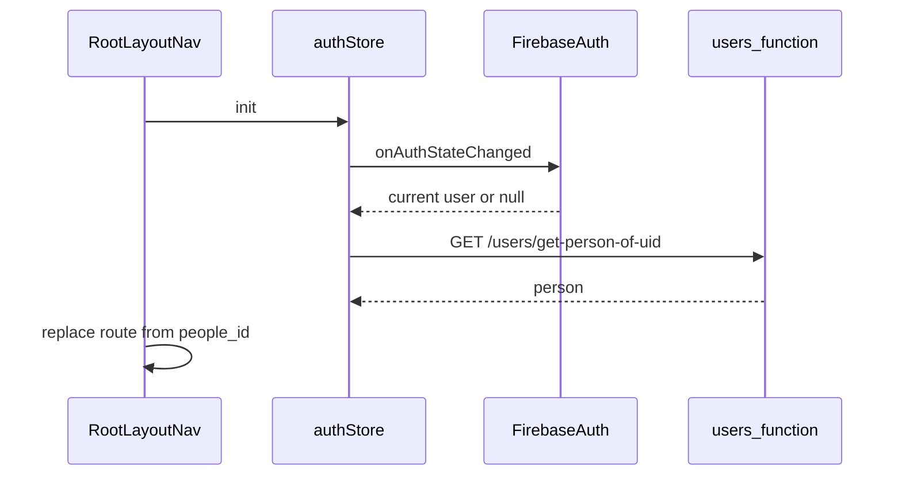
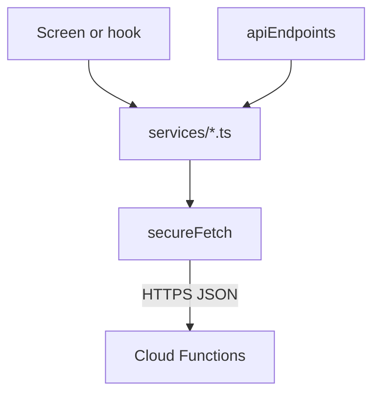

# Mobile Application Architecture

Member app for SIBKL on iOS and Android. The HTTP API is documented in [../sibkl-cms-backend/ARCHITECTURE.md](../sibkl-cms-backend/ARCHITECTURE.md). System context is in [../ARCHITECTURE.md](../ARCHITECTURE.md).

Status labels: **Implemented**, **Partially implemented**, **Referenced only**, **Not verified**, **Not found**.

## 1. Application overview

`sibkl-app` is an Expo app for people, cells, events, follow-up flows, leader resources, announcements, notifications, and settings. Staff event administration (`eventsAdmin`) is not called from this app.

Package version is `3.0.0`. `package.json` `main` is `expo-router/entry`.

## 2. Technology stack

| Item | Version or package |
| --- | --- |
| Expo | `^53.0.25` |
| React Native | `0.79.6` |
| React | `19.0.0` |
| Router | `expo-router` `~5.1.10` |
| Server cache | `@tanstack/react-query` |
| Client state | `zustand` |
| Auth and push | `@react-native-firebase/app`, `auth`, `messaging` |
| UI | React Native Paper, NativeWind, `@gorhom/bottom-sheet` |
| HTTP | `fetch` in `utils/secureFetch.ts` |
| Ability checks | `@casl/ability` |

`@casl/react` is installed. No import of it was found. `components/shared/Can.tsx` exists and no `<Can>` usage was found. **Referenced only.**

`expo-secure-store`, AsyncStorage, MMKV, and SQLite are **Not found** in dependencies.

## 3. Platform architecture



`app.config.ts` sets `newArchEnabled: false`, scheme `sibklapp`, and plugins for `expo-router`, `expo-camera`, `expo-notifications`, and the three React Native Firebase packages. iOS bundle id is `com.sibkl.app` when `APP_ENV` is `production`, otherwise `com.sibkl.app.staging`. Google service file names switch the same way: `GoogleService-Info.plist` or `GoogleService-Info.staging.plist`, and the Android `google-services` pair.

## 4. Application entry points

| Component | File | Responsibility |
| --- | --- | --- |
| Expo entry | `package.json` `main` | `expo-router/entry` |
| Root layout | `app/_layout.tsx` | Query client, auth routing, FCM |
| Index | `app/index.tsx` | Redirects to `/(auth)/sign-up` |
| Config | `app.config.ts` | Name, bundle id, `extra.API_URL` |
| API map | `utils/endpoints.ts` | `{API_URL}/{function}/{path}` |

## 5. Bootstrap lifecycle

1. `app/index.tsx` redirects to `/(auth)/sign-up`. `app/(auth)/index.tsx` redirects to `/(auth)/sign-in`.
2. `app/_layout.tsx` `RootLayoutNav` calls `authStore.init()` on mount.
3. `init` subscribes to `onAuthStateChanged` and runs `handleAuthStateChange` in `hooks/Auth/useAuthHandler.ts`.
4. That hook GETs `users/get-person-of-uid`, stores the person, builds `defineAbilityFor(person)`, and calls `useSystemStore.getState().fetchSystemConfig()`.
5. Routing in `RootLayoutNav`: not loaded goes to `/(auth)/splash`; `isGuest` goes to `/(app)/home`; no Firebase user goes to `/(auth)/sign-in`; no `people_id` goes to `/(auth)/complete-profile`; otherwise `/(app)/home`.
6. When `firebaseUser` is set, `registerAndGetToken` obtains an FCM token and `updateDeviceToken` PUTs `users/update-device-token`.



## 6. Navigation architecture

`app/(auth)/_layout.tsx` is a Stack: `splash`, `sign-in`, `sign-up`, `new-account`, `selected-account`, `verify-otp`, `claim-set-password`, `complete-profile`, `forgot-password`.

`app/(app)/_layout.tsx` is expo-router `Tabs`. Visible tabs are gated by `useFeatureFlag` except Home and Settings: `home`, `cells`, `events` (hidden for guests), `people`, `flows` (title Follow-up, flag `guestFollowUp`), `leaders` (`leadersPage`), `settings`. Tabs with `href: null`: `announcements`, `notifications`, `profile`.

## 7. Screen and component organization

Screens are the files under `app/(app)/` and `app/(auth)/`. Shared UI is under `components/` (`Cells`, `Events`, `Leaders`, `Flows`, `Auth`, `shared`). Feature services are under `services/` and are called from `hooks/`.

| Area | Screens |
| --- | --- |
| Home | `app/(app)/home/index.tsx`, `launch.tsx`, `profile/` |
| Cells | `cells/index.tsx`, `cells/profile/[id].tsx`, `cells/sessions/`, `cells/qrScan.tsx`, `cells/scanner.tsx` |
| Events | `events/index.tsx`, `events/[eventId]/`, `events/qrScan.tsx`, `events/scanner.tsx` |
| People and flows | `people/index.tsx`, `flows/index.tsx`, `profile/[id].tsx` |
| Leaders | `leaders/index.tsx`, `leaders/[category].tsx` |
| Settings | `settings/index.tsx`, change password, change email, delete account, FAQ |

## 8. Feature architecture

Runtime flags come from `GET /system/config`. `hooks/useFeatureFlag.ts` requires the server flag and the launch window. Keys in `types/SystemConfig.ts`: `people`, `guestFollowUp`, `leadersPage`, `cells`, `cellFollowUp`, `cellAttendance`, `events`.

`config/featureFlags.ts` exports `binaryFeatureFlags.isPilotBuild`, which is true when `extra.PILOT_BUILD` is `false` or `"false"`. The `cells`, `cellAttendance`, and `cellFollowUp` binary keys in that file are commented out. No UI import of `binaryFeatureFlags` was found. **Referenced only** for those commented keys.

`app.config.ts` sets `extra.PILOT_BUILD` from `process.env.PILOT_BUILD === "true"`.

## 9. State management

| Store | File | Holds |
| --- | --- | --- |
| `useAuthStore` | `stores/authStore.ts` | Firebase user, app user, guest flag, CASL ability, `personRevision` |
| `useSystemStore` | `stores/systemStore.ts` | Feature flags, launch versions, app status |
| `useClaimStore` | `stores/claimStore.ts` | Selected profile and verification channel, memory only |
| Sign-up pending | `stores/signUpStore.ts` | Email and password in memory until Firebase signup |

TanStack Query defaults in `app/_layout.tsx`: `staleTime` 10 minutes, `gcTime` 5 minutes, refetch on reconnect, no refetch on window focus.

Auth, claim, and sign-up Zustand state is memory-only. It is not written to disk.

## 10. Authentication lifecycle

| Step | Implementation |
| --- | --- |
| Sign-in | `authStore.signIn` calls `signInWithEmailAndPassword`, then `handleAuthStateChange`. Screen `app/(auth)/sign-in.tsx` |
| Guest | `authStore.guestLogin` sets `isGuest` with no Firebase user |
| New account email | `app/(auth)/new-account.tsx` sends `POST /otp/create` and stores pending sign-up |
| Claim list | `app/(auth)/sign-up.tsx` loads `GET /people/with-no-uid` |
| OTP | `app/(auth)/verify-otp.tsx`. SMS success goes to `claim-set-password`. Email with a selected profile verifies then goes there. Email with no profile calls `createUserWithEmailAndPassword` and goes to `complete-profile` |
| Link | `claim-set-password.tsx` creates the Firebase user, then POSTs `users/create-user-with-existing-person` |
| Profile | `complete-profile.tsx` `updatePeople` when a person id was claimed, otherwise `authStore.signUp` which POSTs `users/create-account` |
| Password reset | `app/(auth)/forgot-password.tsx` `sendPasswordResetEmail` |
| Password change | `settings/changePassword` `user.updatePassword` after `ReauthModel` `reauthenticateWithCredential` |
| Email change | `settings/changeEmail` reauth then `updateEmail` |
| Delete | `settings/delete-account` signs in again, calls `DELETE /users/delete-account`, then `deleteUser` and `signOut` |
| Logout | `settings/index.tsx` `handleLogout` calls `authStore.signOut` |

`utils/pendingClaim.ts` reads and writes `pending_claim.json`. No caller was found. **Referenced only.**

`sign-in.tsx` `rememberMe` is component state only. It does not persist credentials.

Account switching is **Not found**.

## 11. Secure token storage

**Not found** as an application secure-store. The Firebase Auth native SDK keeps the session. `utils/secureFetch.ts` reads `getAuth().currentUser` and `getIdToken(user)` when the user exists and `isGuest` is false. Guest and `allowUnauthenticated` requests omit `Authorization`.

## 12. Token refresh

`getIdToken` is called without a force-refresh argument. There is no custom refresh HTTP route. Person data refresh is `authStore.refreshPerson`, which GETs `users/get-person-of-uid` with `skipPersonSync` when `x-person-revision` changes. That is a profile refresh, not an ID-token refresh.

## 13. Backend API communication



`utils/endpoints.ts` sets `apiBaseUrl` from `Constants.expoConfig.extra.API_URL`.

Services and methods that are called:

| Service file | Calls |
| --- | --- |
| `services/Auth/auth.service.ts` | POST `users/create-account`, GET `users/get-person-of-uid`, DELETE `users/delete-account` |
| `services/OTP/otp.service.ts` | POST `otp/send-sms`, `otp/verify-sms`, `otp/create`, `otp/verify`, all with `allowUnauthenticated` |
| `services/User/user.service.ts` | PUT `users/update-device-token` |
| `services/Person/person.service.ts` | GET `people`, `people/paginated`, `people/:id`, `people/scoped`, `people/scoped-masked`, `people/with-no-uid` (unauthenticated), PUT `people/update/:id` |
| `services/Cell/cell.service.ts` | GET `cells`, `cells/public`, `cells/:id`. POST join, remove-members, add-members, toggle-core. PUT member-status |
| `services/CellAttendance/cellAttendance.service.ts` | Session create, sign-in, manual sign-in, remove attendee, list, get, PATCH close, attendance stats |
| `services/Event/event.service.ts` | GET `events?status=published`, GET `events/:id`, POST participants, GET `events/myEvents`, POST `events/claimMyEvents`, POST check-in |
| `services/Flow/flow.service.ts` | GET `flows`, POST `peopleFlows`, PUT `updateCustomAttr`, PUT `updateStep` |
| `services/Flow/assign.service.ts` | POST `assign/person`, `assign/district`, `assign/cell` |
| `services/District/district.service.ts` | GET `districts`, GET `districts/cells/:id` |
| `services/Note/notes.service.ts` | GET, POST, PUT, DELETE notes |
| `services/Notifications/notifications.service.ts` | GET `notifications`, PUT mark-read, PUT mark-closed |
| Announcements service | GET `announcements` |
| Resource service | GET `resources` and `resources?category&page&limit` |
| Template service | GET `templates`, GET `templates/:id`. Create and update functions are commented out |
| `services/System/system.service.ts` | GET `system/config` with `allowUnauthenticated` |

`claim-set-password.tsx` POSTs `users/create-user-with-existing-person` directly.

Endpoint constants with no service caller: `peopleFlows/add`, `complete`, `updateLastContacted`, `updateStatus`, `districts/people/:id`, `flows/create`, `flows/:id`, `flows/update/:id`, `notes/createBulk`, `notifications/mark-unread`, `notifications/mark-reopen`. **Referenced only.**

`templates.update` in `utils/endpoints.ts` points at `announcements/update/:id`. The update function that would use it is commented out.

## 14. Firebase integration

| Product | Status |
| --- | --- |
| Auth | **Implemented** in `stores/authStore.ts` and settings screens |
| Cloud Messaging | **Implemented** in `app/_layout.tsx` |
| Firestore | **Not found** |
| Cloud Storage | **Not found** |

`getApp()` from `@react-native-firebase/app` is used to obtain the messaging instance.

## 15. Local persistence

`expo-file-system` in `stores/systemStore.ts`:

| File under `documentDirectory` | Contents |
| --- | --- |
| `seen_launch_version.txt` | Last seen launch version |
| `activated_launch_version.txt` | Activated launch version |
| `system_feature_flags.json` | Last feature flags |

QR share writes `session-{id}-qr.png` under the cache directory from `app/(app)/cells/sessions/[sessionId].tsx` and `components/Cells/CreateSessionSheet.tsx`. Announcement share uses `FileSystem.downloadAsync`.

## 16. Offline behavior

An offline write queue is **Not found**. TanStack Query keeps successful responses in memory for `gcTime`. Feature flags on disk are used when `fetchSystemConfig` fails. `systemStore.ts` comments describe the API as the source for flags. Cell and event screens do not read a local database.

## 17. Push notifications

`app/_layout.tsx`:

- `Notifications.setNotificationHandler` from `expo-notifications` shows banner, list, sound, and badge.
- Android channel `default`, then `Notifications.requestPermissionsAsync`.
- FCM `requestPermission`, `getToken`, `subscribeToTopic(messaging, "system-config")`.
- `setBackgroundMessageHandler` logs the message.
- `onMessage`: if `data.type` is `system_config_updated`, waits `Math.random() * 5000` ms and refetches system config.
- `onNotificationOpenedApp` and `getInitialNotification` log only. They do not navigate.
- AppState `active` calls `refetchConfigIfStale` after 5 minutes.

The device token is stored by `PUT /users/update-device-token` with the Firebase uid and the token.

## 18. Deep linking

Scheme `sibklapp` is set in `app.config.ts`. `expo-linking` imports, URL listeners, and auth callback routes are **Not found**.

`app/(app)/events/scanner.tsx` comments that it remains for existing links. The screen `router.replace`s to `/(app)/events/qrScan` with `eventId` and `participantId`.

## 19. Native platform integrations

| Integration | Where |
| --- | --- |
| Camera QR | `expo-camera` `CameraView` in `cells/qrScan.tsx` and `events/qrScan.tsx` |
| Notifications | `expo-notifications` plus FCM |
| Share | `expo-sharing` for QR images |
| Email link | `react-native-email-link` is a dependency used from components |
| Haptics, blur, web browser | Packages are installed. Usage outside `app/`, `services/`, `hooks/`, and `stores/` was not fully traced. **Not verified** as feature entry points |

## 20. Device permissions

`app.config.ts` iOS `NSCameraUsageDescription` and the `expo-camera` plugin text say the camera is used to scan QR codes. `UIBackgroundModes` includes `remote-notification`. Android notification permission is requested at runtime in `registerAndGetToken` for API 33 and above via `expo-notifications`.

`cells/scanner.tsx` requests camera permission and then routes onward.

## 21. File and image uploads

An image picker, `FormData` upload, or multipart client is **Not found**. Leader media is displayed from URLs. Vimeo playback uses a WebView in `components/Leaders/VimeoPlayer.tsx` and related helpers in `utils/vimeo.ts`. QR images are generated with `react-native-qrcode-svg` and shared. They are not uploaded to the API.

## 22. Error handling and logging

`secureFetch` returns the `Response` and does not throw on HTTP status. It throws `SecureFetch: User not signed in` when there is no user, the session is not a guest, and the call is not `allowUnauthenticated`.

Sign-in maps `auth/invalid-credential` to a fixed string in `authStore.signIn`. OTP screens surface the backend message when the response indicates the SMS rate limit.

`console.log` in `app/_layout.tsx` prints the FCM token. `utils/endpoints.ts` prints `ENV` and `API`. Toasts use `react-native-toast-message`.

## 23. Environment configuration

`app.config.ts` `extra`:

| extra field | Source |
| --- | --- |
| `ENV` | `APP_ENV` |
| `API_URL` | `API_URL` |
| `PILOT_BUILD` | `PILOT_BUILD === "true"` |
| `eas.projectId` | Literal Expo project id in `app.config.ts` |

EAS `eas.json` sets `API_URL` for `staging` to the `leafy-loader-444703-d0` functions host and for `production` and `pilot` to the `sibklcms-prod` functions host. `development` does not set `API_URL` in that file. Local scripts pass `.env.development`, `.env.staging`, or `.env.production` through `dotenv-cli`.

## 24. Android and iOS build processes

`eas.json` profiles extend `base`. The iOS image is `macos-sequoia-15.6-xcode-26.2`.

| Profile | Distribution | Android artifact |
| --- | --- | --- |
| `development` | internal, dev client, iOS simulator | apk |
| `staging` | internal | app-bundle |
| `production` | store | app-bundle |
| `pilot` | store, `PILOT_BUILD` true | app-bundle |

`expo-build-properties` sets iOS deployment target `15.1` and static frameworks, and Android compile/target SDK 36.

npm scripts `ios:dev`, `ios:staging`, `ios:prod`, `android:*` run `expo run:ios` or `expo run:android` with the matching env file. `start` is `expo start --dev-client`.

## 25. Release and deployment

`eas.json` `submit` profiles `staging`, `production`, and `pilot` set Android track `internal` and iOS App Store Connect ids. Those submit blocks are configuration. A GitHub workflow for this repo is **Not found**.

`cli.appVersionSource` is `remote`. `autoIncrement` is true on the build profiles.

## 26. Security mechanisms implemented

- Firebase Auth on device for email and password, including reauthentication before password or email change.
- API calls attach the Firebase ID token except for guest mode and `allowUnauthenticated` service options.
- Client CASL from `utils/casl/defineAbilityFor.ts` is built in `handleAuthStateChange` and `refreshPerson`. Screens such as `app/(app)/cells/profile/[id].tsx` call `ability.can`. `utils/casl/helper.ts` `canDeleteCellMember` is used on the cell profile screen. `hasAbility` in that helper has no callers.
- Camera permission strings are in `app.config.ts`.
- Account delete calls the backend `DELETE /users/delete-account` and then deletes the Firebase user on the device.

Server authorization is enforced only by the Cloud Functions. This app does not call a permissions API.

## 27. Directory map

```text
sibkl-app/
  package.json
  app.config.ts
  eas.json
  app/_layout.tsx
  app/index.tsx
  app/(auth)/
  app/(app)/
  components/
  services/
  hooks/Auth/useAuthHandler.ts
  hooks/useFeatureFlag.ts
  stores/authStore.ts
  stores/systemStore.ts
  stores/claimStore.ts
  utils/endpoints.ts
  utils/secureFetch.ts
  utils/casl/defineAbilityFor.ts
  config/featureFlags.ts
  types/SystemConfig.ts
```
